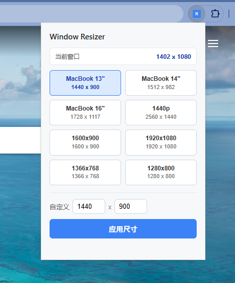

# Window Resizer - Chrome 扩展

前端开发，快速设置浏览器窗口宽高，模拟不同电脑屏幕尺寸。

## 解决什么问题

- F12检查的时候，虽然可以选手机模式，但是像 `@media (max-width:768px) {}` 是按 `window.outerWidth` 生效的
- 而手动调整窗口大小，很难准确的控制比如 `1440x900` 这样的尺寸

## 功能

- 一键切换常见屏幕尺寸
- 自定义输入任意宽高
- 实时显示当前窗口大小
- 默认预设 1440x900

## 预设尺寸

| 名称 | 尺寸 |
| ------ | ------ |
| MacBook 13" | 1440 x 900 |
| MacBook 14" | 1512 x 982 |
| MacBook 16" | 1728 x 1117 |
| 1440p | 2560 x 1440 |
| 1600x900 | 1600 x 900 |
| 1920x1080 | 1920 x 1080 |
| 1366x768 | 1366 x 768 |
| 1280x800 | 1280 x 800 |

## 安装方法

1. 打开 Chrome 浏览器，进入 `chrome://extensions/`
2. 开启右上角「开发者模式」
3. 点击「加载已解压的扩展程序」
4. 选择 `chrome-window-resizer` 文件夹
5. 扩展图标会出现在工具栏

## 使用方法

1. 点击工具栏的 Window Resizer 图标
2. 选择预设尺寸，或输入自定义宽高
3. 点击「应用尺寸」按钮
4. 当前浏览器窗口会立即调整大小

## 注意事项

- 窗口大小不能小于浏览器最小限制
- 部分操作系统可能有额外的窗口尺寸限制
- 如果窗口最大化，需先取消最大化才能调整
